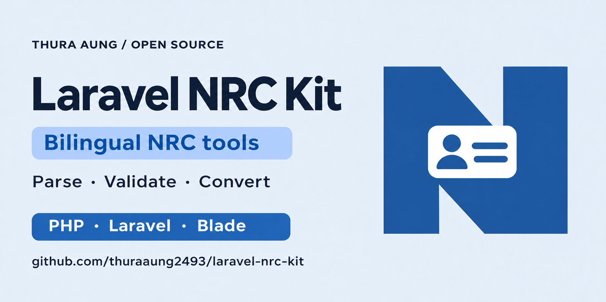

# Laravel NRC Kit



By [Thura Aung](https://github.com/thuraaung2493).

Parse, convert and validate Myanmar NRC numbers in English and Myanmar.
Includes a Blade selector and works offline.

## Install

<!-- installation-command:start -->

```sh
composer require thuraaung2493/laravel-nrc-kit
```

<!-- installation-command:end -->

See [installation and requirements](docs/installation.md).

## Basic usage

```php
use Thuraaung\NrcKit\Nrc;

Nrc::from('12/LaMaNa(N)001234')->isValid(); // true
Nrc::from('၁၂/လမန(နိုင်)၀၀၁၂၃၄')->toEnglish(); // '12/LaMaNa(N)001234'
```

Continue with the [quick start](docs/quick-start.md) and [API reference](docs/api-reference.md).

## Laravel validation

See the [Laravel validation guide](docs/guides/validation.md).

## Blade selector

See the [Blade selector guide](docs/guides/blade-selector.md).

## Customize NRC data

See the [custom data guide](docs/guides/custom-data.md) and [data notes](data/README.md).

## Contributing

See [contributing](CONTRIBUTING.md) for development and verification instructions.
