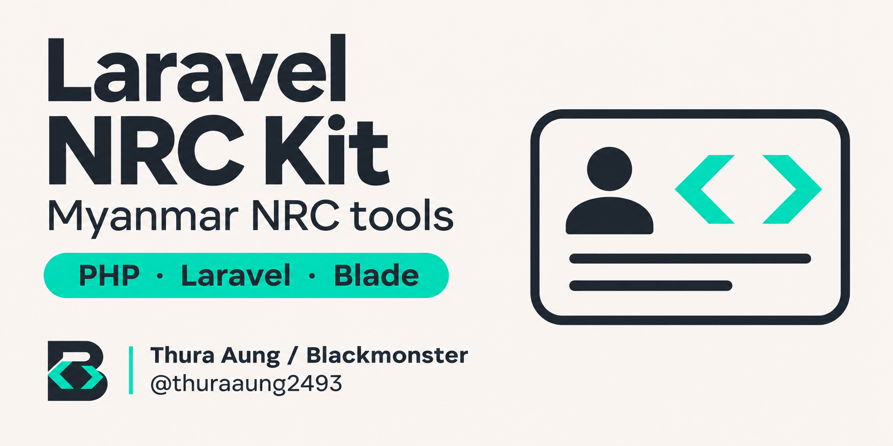

# Laravel NRC Kit



By [Thura Aung / Blackmonster](https://github.com/thuraaung2493).

Parse, convert and validate Myanmar NRC numbers in English and Myanmar.
Includes a Blade selector and works offline.

## Install

Supports PHP 7.4–8.5 and Laravel 7–13, with JSON and mbstring enabled.
Use a PHP version compatible with your Laravel version.

```sh
composer require thuraaung2493/laravel-nrc-kit
```

Laravel discovers the service provider automatically.

## Basic usage

```php
use Thuraaung\NrcKit\Nrc;

Nrc::from('၁၂/လမန(နိုင်)၀၀၁၂၃၄')->toEnglish(); // '12/LaMaNa(N)001234'
Nrc::from('12/LaMaNa(N)001234')->toMyanmar(); // '၁၂/လမန(နိုင်)၀၀၁၂၃၄'
Nrc::from('12/LaMaNa(N)001234')->isValid(); // true
Nrc::from('12/LaMaNa(N)12345')->isValid(); // false

Nrc::from('12/LaMaNa(N)001234')->parse('mm');
// [
//     'state' => '၁၂',
//     'stateName' => 'ရန်ကုန်တိုင်း',
//     'township' => 'လမန',
//     'type' => 'နိုင်',
//     'typeName' => 'နိုင်ငံသား',
//     'number' => '၀၀၁၂၃၄',
//     'language' => 'mm',
// ]
```

`parse()` returns `null` for invalid input. Its default `auto` language follows
the input's township script; `en` or `mm` selects the returned language. The
returned `language`, `stateName` and `typeName` describe that output. Keep serial
numbers as strings to preserve leading zeroes.

Supported types are `N`/`နိုင်` (Full Citizen), `E`/`ဧည့်` (Associate Citizen),
`P`/`ပြု` (Naturalized Citizen) and `M`/`သ` (Monk). `AE` is an alias of `E`.
Nun is not supported. A valid NRC also needs a known state/township pair and
exactly six digits. Validation does not verify identity or document issuance.

Other helpers:

| Helper                             | Purpose                                                              |
| ---------------------------------- | -------------------------------------------------------------------- |
| `Nrc::from($input)->convert('mm')` | Convert to the selected language                                     |
| `Nrc::from($input)->isInvalid()`   | Check whether an NRC is invalid                                      |
| `Nrc::from($input)->validate()`    | Return `valid` and `errors` with `code`/`message`                    |
| `Nrc::fromParts($parts)`           | Build an NRC from string `state`, `township`, `type`, `number` parts |
| `Nrc::states('mm')`                | Named regions: `stateNo`, `name`                                     |
| `Nrc::townships(12, 'mm')`         | Myanmar township code strings                                        |
| `Nrc::townships(12)`               | Bilingual township pairs: `en`, `mm`                                 |
| `Nrc::types('mm')`                 | Supported type options                                               |

`Nrc::types()` returns `en`, `mm` and a localized `label`. State number 9 has
separate Naypyidaw and Mandalay records. Parsing uses known township codes to
choose the name; selectors combine both names into one state-number option.

Conversion and building from parts throw on invalid input. Use `isValid()` or
`validate()` when handling user input.

## Laravel validation

```php
use Thuraaung\NrcKit\Rules\ValidNrc;

$request->validate([
    'nrc' => ['required', new ValidNrc()],
]);
```

## Blade selector

Publish the browser asset before using the selector. No Node or frontend
framework is required.

```sh
php artisan vendor:publish --tag=nrc-kit-assets
```

```blade
<x-nrc-selector
    name="nrc"
    :value="old('nrc', $client->nrc ?? null)"
    language="mm"
    required
/>
```

`language` accepts `en`, `mm` or `auto` (default). The selector submits one
complete NRC under `name` (default `nrc`) and supports `disabled`, `id`, `class`
and `error`. It displays Laravel validation errors automatically. Validate the
submitted value with `ValidNrc` on the server.

To switch language in the browser, give the selector an `id` and call:

```js
window.NrcKit.setLanguage(document.getElementById("your-selector-id"), "mm");
```

Selections and leading zeroes are preserved. For dynamically inserted selectors,
call `window.NrcKit.init(element)` after the asset has loaded.

## Customize NRC data

Publish the full dataset to `config/nrc-kit.php`:

```sh
php artisan vendor:publish --tag=nrc-kit-config
```

The file contains all 14 states and 429 township pairs directly as a PHP array:

```php
return [
    'data' => [
        [
            'state' => '1',
            'townships' => [
                [
                    'en' => 'MaKaNa',
                    'mm' => 'မကန',
                ],
                // Other township pairs...
            ],
        ],
        // Other states...
    ],
];
```

Edit, add or remove records in this array. All methods, `ValidNrc` and the Blade
selector use it automatically. There is no separate JSON dataset or merge step.
Configuration order is preserved; an empty `data` array accepts no NRCs.

States are positive English digit strings without leading zeroes and must fit
a safe integer. Each township
needs an English letter code (`en`) and a Myanmar code (`mm`), without spaces
or separators. Duplicate states or township codes and malformed records throw
an `InvalidArgumentException`. The config also contains `states` for bilingual region names and `types` for
codes and descriptions (`label` in English, `labelMm` in Myanmar). Six-digit
serial rules stay fixed.

After deployment changes, rebuild your Laravel configuration cache and restart
long-running workers. Render selectors again to load changed data. A published
copy is maintained by your application and does not automatically receive future
dataset updates from this package.

If you used the earlier `additional_data` option, move those records into the
full `data` array; that option has been replaced.

See [data notes](data/README.md) for the bundled dataset's source and limitations.
